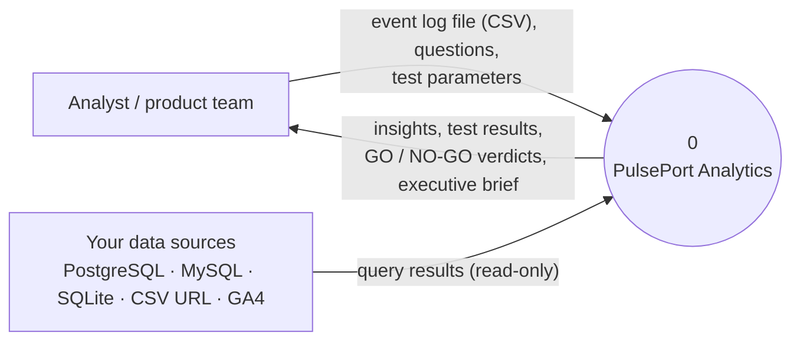
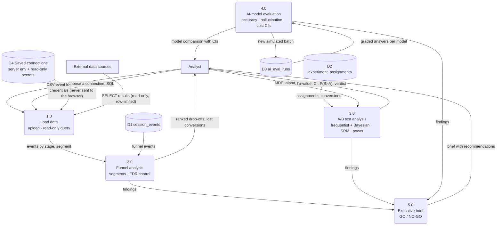
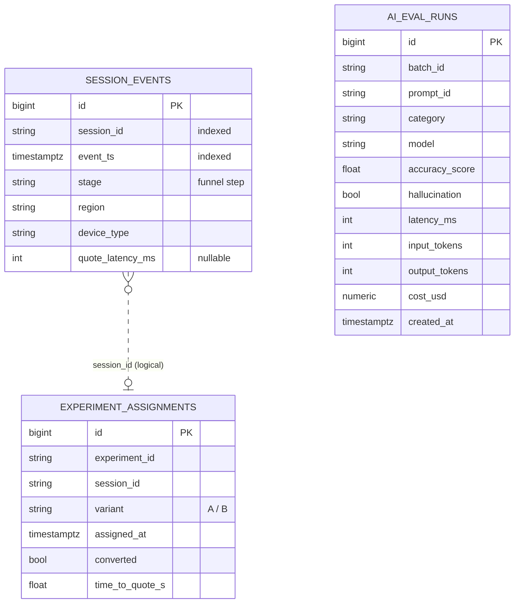

# PulsePort Analytics: Data Flow & Data Model

Drawn from the code: the ORM models in [`backend/app/models.py`](../backend/app/models.py), the read-only connectors in [`backend/app/connectors/`](../backend/app/connectors/), the statistics engine in [`backend/app/stats_engine/`](../backend/app/stats_engine/) and its browser port in [`frontend/src/lib/`](../frontend/src/lib/). GitHub renders the diagrams directly.

**DFD notation:** rectangles are external entities, numbered rounded boxes are processes, cylinders are data stores.

## DFD Level 0: context diagram

## DFD Level 1

The live demo runs processes 1.0 to 3.0 entirely in the browser (TypeScript port of the engine), so uploaded data never leaves the device. The self-hosted server adds PostgreSQL and the read-only connectors.

## ERD

PulsePort stores **analytical fact tables**, not a transactional model: each table is an append-only log that the statistics engine aggregates. There are no foreign keys; `session_id` is the logical link between a session's funnel events and its experiment assignment.

Indexes follow the queries: `(stage, region, device_type)` and `event_ts` for funnel segmentation, `(experiment_id, variant)` for A/B analysis, and `(model, category)` for model comparison.

The demo data is generated by the seeder (a maritime booking portal). A new AI-evaluation batch is also simulated; in a real deployment `run_batch` would call each provider's API and grade the answers.
